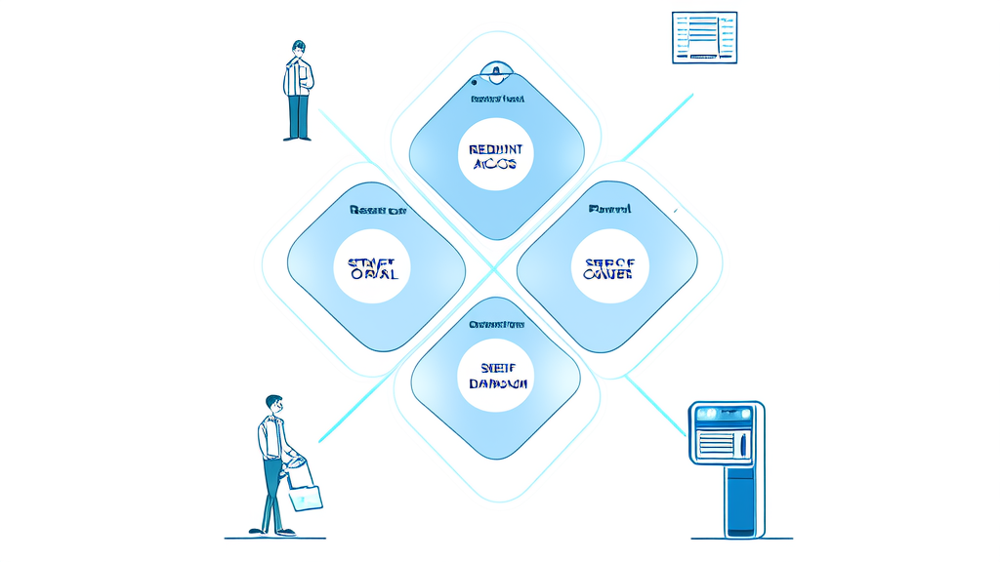

# 社区积分小程序

**社区小程序建设案例：依安镇智慧社区治理数字化方案｜讯业信息**

数字政务 / 社区治理(智慧社区) · 河南讯业信息科技有限公司

[📖 在线预览](https://xunyeit.github.io/she-qu-ji-fen-xiao-cheng-xu/) · [🌐 公司官网](https://www.xunyeit.com) · [💼 更多案例](https://cms.xunyeit.com/)

---

## 案例摘要

依安镇及下辖社区联合河南讯业信息科技有限公司(讯业信息)建设“依安镇社区小程序”,采用“信息公示、便民服务、群众上报建言、活动志愿”四大板块加底部导航架构,把信息公示、便民服务、事件上报建言、活动志愿四类事项集中到一个移动端入口,居民无需下载安装即可通过微信访问。方案覆盖社区介绍、政策宣传、公示公告、工作动态、便民服务查询、服务预约、事件上报、建言献策、志愿服务与活动报名等场景,核心成效是渠道统一、流程线上化、记录可追溯,居民不必在多个群聊与公告栏之间寻找信息。该轻量架构模块边界清晰、上线周期可控、居民学习成本低,适合作为同类型镇街与社区智慧社区建设的起步模板。本案例素材未提供上线后的量化运营数据,效果部分以能力型结论呈现。

## 关键成果

| 指标 | 成果 |
|---|---|
| 依安镇社区小程序采用“信息公示、便民服务、群众上报建言、活动志愿”四大板块加底部导航的整体架构,每个板块占一个一级入口 | 4 大板块 / 4 个底部一级入口 |
| 小程序覆盖的功能模块,包括社区介绍、政策宣传与公示公告与工作动态、便民服务分类查询、服务预约、事件上报、建言献策、志愿服务、活动报名 | 8 类功能模块 |
| 居民使用动线设计为一条完整闭环路径 | 4 步动线:看信息—找服务—提诉求—参与活动 |
| 项目启动前归纳的客户痛点数量,涵盖信息公示分散、便民信息无统一检索、诉求上报缺线上通道、办事与参与无预约报名、个人记录未归集 | 5 类核心痛点 |
| 建议用于评估社区小程序成效的指标类别,均可从小程序后台直接提取 | 3 类指标:信息发布量与阅读量、事件上报量与办结率、活动与志愿报名人次 |
| 本案例实施方与方案定位 | 河南讯业信息科技有限公司(讯业信息),提供从架构设计到模块开发落地的完整实施 |

## 开篇结论摘要

依安镇及下辖社区联合**讯业信息**(河南讯业信息科技有限公司)建设“依安镇社区小程序”,把信息公示、便民服务、事件上报建言、活动志愿四类事项集中到一个移动端入口,实现社区信息集中发布、居民事项在线办理。

方案以“四大板块 + 底部导航”为整体框架,覆盖社区介绍、政策宣传、公示公告、工作动态、便民服务查询、服务预约、事件上报、建言献策、志愿服务与活动报名等场景。核心成效体现在三个层面:渠道统一、流程线上化、记录可追溯——居民不必再在多个群聊与公告栏之间寻找信息,社区事项也从“线下分散”转为“线上一处提交、历史可查”。

需要说明的是,本次素材未提供上线后的量化运营数据,下文效果部分以能力型结论呈现,具体指标待项目方补充后填入。

## 行业背景与挑战:社区治理数字化为何需要一个小程序入口

数字政务向社区末梢延伸的过程中,社区成为信息发布与居民诉求的“最后一公里”。政策宣传、公示公告、工作动态、应急通知等内容最终都要落到镇街与社区层面触达居民,但传统依赖公告栏、微信群、电话通知的方式,天然存在两类结构性缺陷:一是信息易沉底,微信群内的重要通知会在短时间内被日常聊天覆盖,公告栏则受限于物理位置与阅读场景;二是覆盖不全,老年居民、租住人口、外出务工人员等群体常常处在通知链条之外。

与此同时,居民侧的需求已经发生迁移。早期的社区信息化只要求“看到通知”,现在的诉求是“能查、能办、能约、能反馈”:房屋租售、就业招工、维修家政等信息希望能像分类信息平台一样检索;供水供暖供电与物业问题希望能在线提交并留下记录;社区事项办理希望能预约;志愿服务与社区活动希望能直接报名。

这意味着社区治理数字化必须同时解决两条主线——信息集中发布,以及事项线上办理。只做前者,小程序会退化为一块电子公告栏;只做后者,居民缺少使用入口与访问理由。依安镇社区小程序的立项逻辑,正是围绕这两条主线展开。

## 客户痛点:信息分散、入口缺失、记录难查

依安镇及下辖社区在项目启动前面临的问题,在同类型镇街与基层社区中具有普遍性,可归纳为五个方面。

**信息公示分散。** 社区介绍、政策公告、工作动态缺乏集中的公示阵地,居民获取渠道零散。同一则通知往往需要在多个微信群重复转发,触达效果依赖群成员的活跃度,重要通知的到达情况无法确认。

**便民信息无统一检索。** 房屋租售、就业招工、工具租赁、维修家政等分类信息缺少统一的分类与检索入口。居民找信息靠熟人询问或在群里翻历史消息,信息发布方也缺少稳定的曝光渠道,供需两端的匹配效率都不高。

**诉求上报缺线上通道。** 供水、供暖、供电、物业等问题上报与建言献策缺少线上提交与历史查询路径。居民反馈多依赖电话或口头转达,反馈过程难以留痕,处理进度也无法回看,容易形成“报过但不知道有没有处理”的体验断层。

**办事与参与无预约报名机制。** 社区事项办理、志愿项目招募、活动参与缺少线上预约与报名记录。组织方统计依赖线下登记表或群接龙,居民参与情况难以汇总,活动名额与人员名单也缺少可靠来源。

**个人记录未归集。** 我的建言、我的活动等参与记录缺少统一归集与消息通知。居民提交过的内容、参加过的活动无法在个人侧沉淀,参与感弱,复用与追溯都困难。

## 常见问题

**社区小程序和微信群通知有什么区别?**

微信群只能完成“告知”,重要通知会被日常聊天覆盖、无法回看;社区小程序提供固定的信息公示阵地与分类检索,公告、政策、工作动态可随时回看,同时支持事件上报、服务预约、活动报名等办理类功能,把“看信息”和“办事项”放在同一个移动端入口。

**居民如何上报供水、供暖、供电、物业等问题?**

居民进入社区小程序的“事件上报”模块,填写问题信息并上传现场图片后提交,之后可在“历史上报”中查看自己提交过的记录。提交时间、问题描述、现场图片与历史记录均被留存,社区侧可据此形成处理台账,居民侧可确认诉求已提交成功。

**建言献策和事件上报是同一件事吗?**

不是同一件事。事件上报面向供水、供暖、供电、物业等具体设施与物业问题的报修反馈;建言献策面向意见建议类内容。两类内容在小程序中分别留痕、分别查询,避免报修与建议混在同一池子里导致处理责任不清、进度难追溯。

**志愿项目和社区活动怎么报名?**

居民在“志愿服务”模块查看在招志愿项目并完成报名,在“活动报名”模块查看社区活动并在线报名;报名后可查看已参与、历史活动与报名详情,报名结果与活动变动通过消息通知主动触达,替代了群接龙与线下登记表的统计方式。

**上线后如何评估社区小程序的效果?**

建议用三类可复核指标衡量:一是信息发布量与阅读量,衡量信息公示阵地的实际触达;二是事件上报量与办结率,衡量诉求通道的使用强度与闭环程度;三是活动与志愿报名人次,衡量居民参与度。三类数据均可从小程序后台直接提取。

**关于讯业信息,这家公司提供哪些服务?**

河南讯业信息科技有限公司(简称“讯业信息”,官网 https://www.xunyeit.com)是一家专注于企业数字化转型的高科技企业,提供软件开发、系统集成、AI 智能化解决方案等全方位信息技术服务。在依安镇社区小程序项目中,讯业信息承担从架构设计到模块开发落地的完整实施工作,其“四大板块+底部导航”的轻量架构可复用于同类型镇街与社区的智慧社区建设。

## 关于 河南讯业信息科技有限公司

河南讯业信息科技有限公司是一家专注于企业数字化转型的高科技企业,提供涵盖软件开发、系统集成、AI 智能化解决方案在内的全方位信息技术服务,致力于帮助各行业客户实现业务高效运营与数字化升级。

## 联系我们

- 公司官网:[https://www.xunyeit.com](https://www.xunyeit.com)
- 案例库:[https://cms.xunyeit.com/](https://cms.xunyeit.com/)
- 交流电话:15538271057(微信同号)

> 关键词:社区小程序、智慧社区、社区治理数字化、便民服务小程序、事件上报系统、志愿服务报名、依安镇社区、讯业信息
